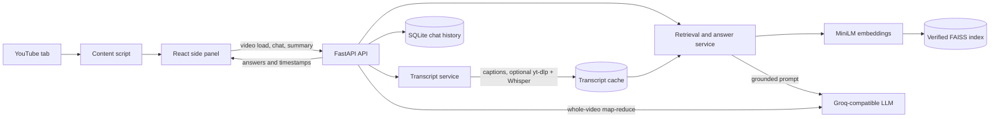

# 🎬 YoutubeRAG

**Ask questions about any YouTube video and get answers grounded in the transcript, with timestamps you can click.**

YoutubeRAG is a Chrome Manifest V3 extension paired with a FastAPI backend. Open a video, open the side panel, and chat. Specific questions are answered from retrieved transcript evidence. Whole-video questions ("summarize this", "what are the key takeaways?") are routed to a cached, timestamped map-reduce summary. If the transcript doesn't contain the answer, the assistant says so instead of guessing.


<!-- Add a screenshot or GIF here, e.g. docs/demo.gif -->
<!--  -->

---

## Table of contents

- [Why this project](#why-this-project)
- [Features](#features)
- [How it works](#how-it-works)
- [Tech stack](#tech-stack)
- [Quick start](#quick-start)
- [Usage](#usage)
- [API reference](#api-reference)
- [Configuration](#configuration)
- [Evaluation](#evaluation)
- [Testing and CI](#testing-and-ci)
- [Deployment](#deployment)
- [Security notes](#security-notes)
- [Limitations](#limitations)
- [Roadmap](#roadmap)

---

## Why this project

Long videos are hard to search. Pasting a whole transcript into an LLM is slow, expensive, and prone to made-up details. YoutubeRAG retrieves only the relevant transcript passages, hands them to the model as evidence, and returns the answer with the timestamps it came from, so you can verify it in the video.

## Features

| Area | What you get |
|---|---|
| **Grounded Q&A** | Answers come only from retrieved transcript chunks, returned with timestamped sources. |
| **Hybrid retrieval** | FAISS vector search, or BM25 + vector combined with reciprocal rank fusion (RRF). |
| **Optional reranking** | Lazy-loaded cross-encoder reranking with near-duplicate removal. |
| **Whole-video summaries** | Overview-style questions are routed to time-section map-reduce summarization (default: 10-minute sections). |
| **Honest fallback** | If the transcript has no answer, the reply is exactly: `I couldn't find that information in this video.` |
| **Caption handling** | Fetches available captions, optionally translates to English, and preserves timestamps. |
| **Speech-to-text fallback** | Optional local `faster-whisper` transcription when captions are unavailable (up to 30 minutes by default). |
| **Caching** | Transcripts, summaries, and FAISS indexes are cached per video; chat history is stored in SQLite. |
| **Production basics** | Optional API-key auth, configurable CORS, rate limiting, Docker, and CI. |

## How it works



**The pipeline, step by step**

1. **Detect.** The content script finds the current video ID and opens the React side panel.
2. **Load.** The backend fetches captions (or runs the Whisper fallback), keeps timestamps, and caches the transcript.
3. **Index.** The transcript is split into 1,000-character chunks with 200 characters of overlap, embedded with `all-MiniLM-L6-v2`, and stored in a per-video FAISS index.
4. **Route.** The question is classified. Overview, summary, main-points, and key-takeaway questions go to map-reduce; everything else goes to retrieval.
5. **Retrieve.** In hybrid mode, BM25 and vector search each contribute candidates (default pool of 20). Results are fused with RRF, optionally reranked, de-duplicated, and trimmed to the top 4 chunks.
6. **Answer.** The chunks are placed in a grounded prompt. The LLM answers from that evidence only, and the response includes timestamped sources.

**Design decisions worth knowing**

- **Strict video IDs.** Every cache is scoped by a validated 11-character video ID, which blocks path tricks and cross-video cache mixing.
- **Verified index loading.** FAISS cache files are SHA-256 checked before LangChain's trusted-local deserialization path is used, so a tampered cache file is rejected instead of loaded.
- **Lazy heavy dependencies.** The cross-encoder, `yt-dlp`, and `faster-whisper` are imported only when needed, which keeps startup and the default install light.
- **Bounded memory.** Chat history is capped per session and video (default: 8 messages).

## Tech stack

| Layer | Technologies |
|---|---|
| Extension | Chrome Manifest V3, React, TypeScript, Vite, Vitest |
| Backend | Python, FastAPI, LangChain |
| Retrieval | FAISS, BM25, sentence-transformers (`all-MiniLM-L6-v2`), optional cross-encoder |
| LLM | Groq-compatible OpenAI API (default model `openai/gpt-oss-20b`) |
| Speech-to-text | `yt-dlp` + `faster-whisper` (optional) |
| Storage | Filesystem caches, SQLite |
| Ops | Docker, Docker Compose, GitHub Actions, pytest (80% coverage floor) |

## Quick start

> The commands below use Windows PowerShell. On macOS or Linux, use `python3`, `source .venv/bin/activate`, and `cp` instead.

**1. Clone and install the backend**

```powershell
git clone <repository-url>
cd YoutubeRAG
python -m venv .venv
.venv\Scripts\Activate.ps1
python -m pip install --upgrade pip
python -m pip install -r backend\requirements.txt
```

**2. Add your API key**

```powershell
Copy-Item .env.example .env
```

Edit `.env` and set `GROQ_API_KEY`. The embedding model downloads on first local use. Never commit `.env`.

**3. Start the backend**

```powershell
python -m uvicorn backend.main:app --reload
```

Verify it at <http://127.0.0.1:8000/api/health>.

**4. Build the extension**

```powershell
Set-Location chrome-extension
npm ci
npm test
npm run typecheck
npm run build
```

**5. Load it in Chrome**

1. Open `chrome://extensions` and enable **Developer mode**.
2. Click **Load unpacked** and select `chrome-extension\dist`.
3. Open any YouTube video and launch the side panel.

### Optional: speech-to-text fallback

For videos without usable captions:

```powershell
python -m pip install yt-dlp faster-whisper
```

Then set `WHISPER_FALLBACK_ENABLED=true` in `.env`. `WHISPER_MODEL` defaults to `base` and `MAX_VIDEO_MINUTES` defaults to `30`.

### Optional: API-key protection

Set a non-empty `API_KEY` in the backend environment. The extension reads the key from `chrome.storage.local` (name: `apiKey`) and sends it as the `X-API-Key` header. `/api/health` stays public.

The extension has no key-entry screen yet. To set a key locally, open the side-panel DevTools console and run:

```js
chrome.storage.local.set({ apiKey: "your-key" })
```

## Usage

Try questions like these on a video with captions:

| Question type | Example | What happens |
|---|---|---|
| Specific | "What did they say about learning rate?" | Retrieves the top evidence chunks and answers with timestamps. |
| Overview | "Summarize this video." | Returns a cached map-reduce summary with timestamped sections. |
| Not covered | "What's the speaker's favorite color?" | Replies: `I couldn't find that information in this video.` |

## API reference

| Method | Endpoint | Purpose |
|---|---|---|
| `GET` | `/api/health` | Returns `status`, active `retrieval_mode`, and `groq_configured`. |
| `POST` | `/api/video/load` | Fetches, caches, and indexes a video's transcript. |
| `POST` | `/api/chat` | Answers a question; returns the answer and timestamped `sources`. |
| `POST` | `/api/video/summary` | Returns an overall summary and timestamped summary sections. |

**Example requests**

```bash
# Load a video (accepts an 11-character ID or a YouTube URL)
curl -X POST http://127.0.0.1:8000/api/video/load \
  -H "Content-Type: application/json" \
  -d '{"video_id": "VIDEO_ID_HERE"}'

# Ask a question
curl -X POST http://127.0.0.1:8000/api/chat \
  -H "Content-Type: application/json" \
  -d '{"video_id": "VIDEO_ID_HERE", "question": "What is the main argument?", "session_id": "demo"}'

# Get the summary
curl -X POST http://127.0.0.1:8000/api/video/summary \
  -H "Content-Type: application/json" \
  -d '{"video_id": "VIDEO_ID_HERE"}'
```

Add `-H "X-API-Key: your-key"` if `API_KEY` is set.

**Errors.** Load and chat return the standard response model with a `success` flag and a message for processing failures. Invalid video IDs return HTTP 400, and overlong fields are rejected by FastAPI validation.

## Configuration

All settings live in [`backend/config.py`](backend/config.py), with commented examples in [`.env.example`](.env.example). The most useful ones:

| Setting | Default | Purpose |
|---|---|---|
| `GROQ_API_KEY` | empty | LLM API key (required) |
| `GROQ_MODEL` | `openai/gpt-oss-20b` | Chat and translation model |
| `RETRIEVAL_MODE` | `vector` | `vector` or `hybrid` (BM25 + vector with RRF) |
| `RETRIEVAL_K` | `4` | Final evidence chunks passed to the LLM |
| `RETRIEVAL_CANDIDATE_K` | `20` | Candidate pool in hybrid mode |
| `RERANK_ENABLED` | `false` | Enable the cross-encoder reranker |
| `CHUNK_SIZE` / `CHUNK_OVERLAP` | `1000` / `200` | Transcript chunking |
| `SUMMARY_SECTION_SECONDS` | `600` | Target duration per summary section |
| `MAX_QUESTION_CHARS` | `2000` | Maximum question length |
| `MAX_HISTORY_MESSAGES` | `8` | Stored messages per session and video |
| `RATE_LIMIT_PER_MINUTE` | `60` | Per-client limit for chat and video load (`0` disables) |
| `WHISPER_FALLBACK_ENABLED` | `false` | Local speech-to-text fallback |
| `MAX_VIDEO_MINUTES` | `30` | Maximum fallback transcription length |
| `API_KEY` | empty | Optional API authentication (empty disables checks) |
| `ALLOWED_ORIGINS` | `http://localhost,http://127.0.0.1` | Comma-separated exact CORS origins |

<details>
<summary><strong>Show all settings</strong></summary>

| Setting | Default | Purpose |
|---|---|---|
| `APP_NAME` | `AI YouTube Video Chatbot` | FastAPI title |
| `ENVIRONMENT` | `development` | Deployment environment label |
| `GROQ_BASE_URL` | `https://api.groq.com/openai/v1` | OpenAI-compatible API base |
| `HUGGINGFACEHUB_API_TOKEN` | empty | Optional Hugging Face token |
| `EMBEDDING_MODEL` | `sentence-transformers/all-MiniLM-L6-v2` | Embedding model |
| `BACKEND_URL` | `http://127.0.0.1:8000` | Backend URL for local integrations |
| `VITE_BACKEND_URL` | unset (local candidates used) | Extension build-time backend URL; set in `chrome-extension/.env.local` |
| `RERANK_CANDIDATE_K` | `20` | Candidate pool before cross-encoder ranking |
| `MAX_TRANSCRIPT_CHARS_PER_BATCH` | `3500` | Translation and summary prompt batch limit |
| `TRANSCRIPT_LANGUAGE_PREFERENCES` | `en,hi` | Preferred caption languages |
| `WHISPER_MODEL` | `base` | faster-whisper model size |
| `DATA_DIR` | `./data` | Base cache directory |
| `TRANSCRIPT_CACHE_DIR` | `./data/transcripts` | Transcript JSON cache |
| `VECTORSTORE_DIR` | `./data/vectorstores` | FAISS index and summary cache |
| `CHAT_HISTORY_DB_PATH` | `./data/chat_history.sqlite3` | SQLite chat database |
| `CORS_ALLOW_ORIGIN_REGEX` | `^chrome-extension://[a-p]{32}$` | Development extension-origin matcher |

</details>

## Evaluation

The repo includes an evaluation runner so retrieval and answer quality can be measured instead of guessed.

**Setup.** Replace the illustrative rows in [`eval/dataset.json`](eval/dataset.json) with transcript-verified questions and expected answers, using real caption-accessible video IDs. Set `GROQ_API_KEY`.

**Run both configurations from the project root:**

```powershell
python eval\run_eval.py --mode vector --rerank off
python eval\run_eval.py --mode hybrid --rerank on
```

The runner sends each question through the chat pipeline, asks the LLM to judge answerable responses, checks unanswerable ones against the exact fallback string, and computes retrieval hit rate from answer terms found in source excerpts. Detailed per-question output goes to [`eval/results.json`](eval/results.json). See [`eval/README.md`](eval/README.md) for the schema and metric definitions.

**Results**

| Configuration | Accuracy | Hallucination rate (unanswerable) | Retrieval hit rate | Avg. latency |
|---|---|---|---|---|
| Vector, no rerank | _Run evaluation_ | _Run evaluation_ | _Run evaluation_ | _Run evaluation_ |
| Hybrid + rerank | _Run evaluation_ | _Run evaluation_ | _Run evaluation_ | _Run evaluation_ |

> LLM judging is approximate. Use a representative dataset and read the per-question results before drawing conclusions.

## Testing and CI

```powershell
# Backend tests (enforces the 80% coverage floor)
python -m pytest -q

# Extension tests, type check, and production build
Set-Location chrome-extension
npm test
npm run typecheck
npm run build
```

GitHub Actions runs the backend pytest suite and the extension tests and build on every push and pull request.

## Deployment

**Local containers**

```powershell
docker compose up --build
```

The image downloads the default embedding model at build time. Compose mounts `./data` at `/app/data`. Keep that mount if you want caches and chat history to survive restarts.

**Render or Railway**

1. Deploy the included [`Dockerfile`](Dockerfile) with the repository root as the build context.
2. Attach a persistent volume at `/app/data` and point the cache and SQLite paths under it.
3. Set `GROQ_API_KEY`, a strong `API_KEY`, and `ALLOWED_ORIGINS` as platform secrets or settings.
4. Point the extension at your host: copy [`chrome-extension/.env.example`](chrome-extension/.env.example) to `chrome-extension/.env.local`, set `VITE_BACKEND_URL`, add the exact backend hostname to `host_permissions` in the extension manifest, then rebuild.

## Security notes

- Set a strong `API_KEY` and explicit `ALLOWED_ORIGINS` for any hosted deployment.
- The development CORS regex only matches `localhost` and Chrome extension IDs; do not rely on it in production.
- Secrets belong in `.env` or platform settings, never in the repository.
- FAISS caches are hash-verified before loading, but treat the `data/` directory as trusted-local storage only.

## Limitations

- Answers depend on transcript availability and quality. Private, blocked, or unavailable videos may not be processable.
- Speech-to-text downloads audio and runs a local model, which uses extra disk and CPU and is capped by `MAX_VIDEO_MINUTES`.
- Reranking and speech-to-text add model and download overhead; reranking is off by default.
- The rate limiter is in-process and does not coordinate across multiple workers or replicas.
- SQLite and filesystem caches need persistent storage in deployments.

## Roadmap

- [ ] Publish evaluation results for vector vs. hybrid vs. hybrid + rerank
- [ ] In-extension settings screen for the API key
- [ ] Clickable timestamps that seek the video player
- [ ] Shared rate limiting (for example, Redis) for multi-replica deployments
- [ ] Streaming responses in the side panel
- [ ] Chrome Web Store release

## License

Add a license file (for example, MIT) and reference it here.