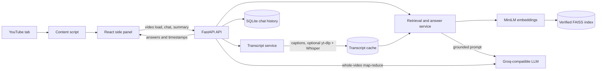

# YoutubeRAG

YoutubeRAG is a Chrome Manifest V3 extension and FastAPI service for asking transcript-grounded questions about the YouTube video open in the browser. It retrieves timestamped evidence for specific questions and can map-reduce a cached, timestamped overview for whole-video questions.

## Architecture



The backend exposes `/api/health`, `/api/video/load`, `/api/chat`, and `/api/video/summary`. Transcript, summary, and vector index caches are scoped by validated 11-character video IDs. Chat history is stored in SQLite by session and video. FAISS cache files are SHA-256 checked before LangChain's trusted-local deserialization path is used.

## Features

- Detects the current YouTube video and opens a React side panel.
- Fetches available captions, optionally translates them to English, and preserves timestamps.
- Answers specific questions using FAISS vector search or hybrid BM25 + vector retrieval with reciprocal rank fusion.
- Optionally lazy-loads a cross-encoder for reranking and removes near-duplicate results.
- Routes overview, summary, main-points, and key-takeaway questions to time-section map-reduce summarization.
- Caches transcripts, summaries, and FAISS indexes per video; stores bounded chat history in SQLite.
- Optionally falls back to local faster-whisper transcription when captions are unavailable.
- Supports optional `X-API-Key` authentication, configured CORS origins, and request rate limits.
- Includes backend pytest coverage, extension Vitest tests, evaluation tooling, Docker, and CI.

If the transcript does not provide an answer, the assistant's required fallback is exactly: `I couldn't find that information in this video.`

## Setup from a fresh clone (Windows PowerShell)

1. Clone the repository and enter its root:

   ```powershell
   git clone <repository-url>
   cd YoutubeRAG
   ```

2. Create and activate a Python environment, then install the backend and test dependencies:

   ```powershell
   python -m venv .venv
   .venv\Scripts\Activate.ps1
   python -m pip install --upgrade pip
   python -m pip install -r backend\requirements.txt
   ```

3. Copy the environment template and set a Groq API key:

   ```powershell
   Copy-Item .env.example .env
   ```

   Edit `.env` and set `GROQ_API_KEY`. The embedding model is downloaded on first local use. Never commit `.env`.

4. Start the backend from the project root:

   ```powershell
   python -m uvicorn backend.main:app --reload
   ```

   Check `http://127.0.0.1:8000/api/health`.

5. Install, test, and build the extension:

   ```powershell
   Set-Location chrome-extension
   npm ci
   npm test
   npm run typecheck
   npm run build
   ```

6. In Chrome, open `chrome://extensions`, enable Developer mode, choose **Load unpacked**, and select `chrome-extension\dist`. Open a YouTube video and launch the extension side panel.

For optional transcript fallback, install `python -m pip install yt-dlp faster-whisper` and set `WHISPER_FALLBACK_ENABLED=true`. The optional packages are imported only if captions cannot be used; `WHISPER_MODEL` defaults to `base`, and `MAX_VIDEO_MINUTES` defaults to 30.

### Optional API-key setup

Set a non-empty `API_KEY` in the backend environment. The extension reads the key from `chrome.storage.local` under the name `apiKey` and sends it in `X-API-Key` on API requests. The health endpoint remains public. The extension has no key-entry UI; to configure a local key, open the extension side-panel DevTools console and run `chrome.storage.local.set({ apiKey: "your-key" })`.

## Configuration

All backend settings are in [`backend/config.py`](backend/config.py), with commented examples in [`.env.example`](.env.example). Empty `API_KEY` disables API-key checks. `WHISPER_FALLBACK_ENABLED` defaults to false. `ALLOWED_ORIGINS` is a comma-separated exact-origin list; valid Chrome extension origins are separately matched by the development regex.

| Setting | Default | Purpose |
|---|---|---|
| `APP_NAME` | `AI YouTube Video Chatbot` | FastAPI title |
| `ENVIRONMENT` | `development` | Deployment environment label |
| `GROQ_API_KEY` | empty | Groq-compatible LLM key |
| `GROQ_MODEL` | `openai/gpt-oss-20b` | Chat and translation model |
| `GROQ_BASE_URL` | `https://api.groq.com/openai/v1` | OpenAI-compatible API base |
| `HUGGINGFACEHUB_API_TOKEN` | empty | Optional Hugging Face token |
| `EMBEDDING_MODEL` | `sentence-transformers/all-MiniLM-L6-v2` | Embedding model |
| `BACKEND_URL` | `http://127.0.0.1:8000` | Backend URL setting for local integrations |
| `VITE_BACKEND_URL` | unset; local candidates used | Extension build-time backend URL; configure in `chrome-extension/.env.local` |
| `CHUNK_SIZE` / `CHUNK_OVERLAP` | `1000` / `200` | Transcript chunking |
| `RETRIEVAL_K` | `4` | Number of final evidence chunks |
| `RETRIEVAL_MODE` | `vector` | `vector` or `hybrid` |
| `RETRIEVAL_CANDIDATE_K` | `20` | Candidate pool when hybrid retrieval is used |
| `RERANK_ENABLED` | `false` | Enable optional cross-encoder |
| `RERANK_CANDIDATE_K` | `20` | Candidate pool before cross-encoder ranking |
| `MAX_QUESTION_CHARS` | `2000` | Maximum accepted question length |
| `MAX_HISTORY_MESSAGES` | `8` | Stored messages per session/video |
| `MAX_TRANSCRIPT_CHARS_PER_BATCH` | `3500` | Translation and summary prompt batch limit |
| `SUMMARY_SECTION_SECONDS` | `600` | Target duration per summary section |
| `TRANSCRIPT_LANGUAGE_PREFERENCES` | `en,hi` | Preferred caption languages |
| `WHISPER_FALLBACK_ENABLED` | `false` | Enable local speech-to-text fallback |
| `WHISPER_MODEL` | `base` | faster-whisper model size |
| `MAX_VIDEO_MINUTES` | `30` | Maximum fallback transcription duration |
| `API_KEY` | empty | Optional API authentication key |
| `DATA_DIR` | `./data` | Base cache directory |
| `TRANSCRIPT_CACHE_DIR` | `./data/transcripts` | Transcript JSON cache |
| `VECTORSTORE_DIR` | `./data/vectorstores` | FAISS index and summary cache |
| `CHAT_HISTORY_DB_PATH` | `./data/chat_history.sqlite3` | SQLite chat database |
| `ALLOWED_ORIGINS` | `http://localhost,http://127.0.0.1` | Comma-separated exact CORS origins |
| `CORS_ALLOW_ORIGIN_REGEX` | `^chrome-extension://[a-p]{32}$` | Development extension-origin matcher |
| `RATE_LIMIT_PER_MINUTE` | `60` | Per-client limit for chat and video load; `0` disables it |

## API

- `GET /api/health`: `status`, active `retrieval_mode`, and `groq_configured`.
- `POST /api/video/load`: `{ "video_id": "11-character-id-or-YouTube-URL" }`.
- `POST /api/chat`: `{ "video_id": "...", "question": "...", "session_id": "..." }`; returns the answer and timestamped `sources`.
- `POST /api/video/summary`: `{ "video_id": "..." }`; returns an overall summary and timestamped summary sections.

The load and chat routes return the established response model with a `success` flag and message for processing failures. Invalid video IDs are rejected with HTTP 400; overlong request fields are rejected by FastAPI validation.

## Evaluation

Replace the illustrative rows in [`eval/dataset.json`](eval/dataset.json) with transcript-verified questions and expected answers. Configure `GROQ_API_KEY` and use real, caption-accessible video IDs. Run either retrieval configuration from the project root:

```powershell
python eval\run_eval.py --mode vector --rerank off
python eval\run_eval.py --mode hybrid --rerank on
```

The runner sends each question through the chat pipeline, asks Groq to judge answerable responses, checks unanswerable responses against the exact fallback, computes retrieval hit rate from answer terms in source excerpts, and writes detailed results to [`eval/results.json`](eval/results.json). See [`eval/README.md`](eval/README.md) for schema and metric definitions.

| Evaluation metric | Result |
|---|---|
| Accuracy | _Run evaluation_ |
| Hallucination rate (unanswerable) | _Run evaluation_ |
| Retrieval hit rate | _Run evaluation_ |
| Average latency | _Run evaluation_ |

## Tests and CI

Backend tests and the configured 80% coverage floor:

```powershell
python -m pytest -q
```

Extension tests and production validation:

```powershell
Set-Location chrome-extension
npm test
npm run typecheck
npm run build
```

GitHub Actions runs the backend pytest suite and extension tests/build on pushes and pull requests.

## Docker and deployment (Render or Railway)

Run the backend locally in containers with persistent cache/history storage:

```powershell
docker compose up --build
```

The Docker image downloads the default embedding model at build time. Compose mounts `./data` at `/app/data`; do not remove that persistent mount if cache/history should survive container restarts.

For Render or Railway, deploy the included [`Dockerfile`](Dockerfile) using the repository root as build context and attach a persistent volume at `/app/data`. Configure `GROQ_API_KEY`, a strong `API_KEY`, and `ALLOWED_ORIGINS` as platform secrets/settings. Set the cache and SQLite paths under `/app/data`. To connect the extension to a hosted backend, copy [`chrome-extension/.env.example`](chrome-extension/.env.example) to `chrome-extension/.env.local`, set `VITE_BACKEND_URL` before building, and add that exact backend hostname to the extension manifest's `host_permissions` before rebuilding.

## Limitations

- Answers and summaries depend on transcript availability and quality; private, blocked, or unavailable videos may not be processable.
- Speech-to-text downloads audio and runs a local model, uses extra disk/CPU, and is limited by `MAX_VIDEO_MINUTES`.
- Cross-encoder reranking and speech-to-text add model/download overhead; reranking is disabled by default.
- The built-in rate limiter is in-process and does not coordinate limits across multiple workers or replicas.
- Local SQLite and filesystem caches require persistent storage in deployments.
- LLM judgment is approximate; curate a representative dataset and inspect detailed per-question results before drawing conclusions.
- Extension development origins are permissive only for localhost and Chrome extension IDs matching the configured regex. Set explicit production origins.
